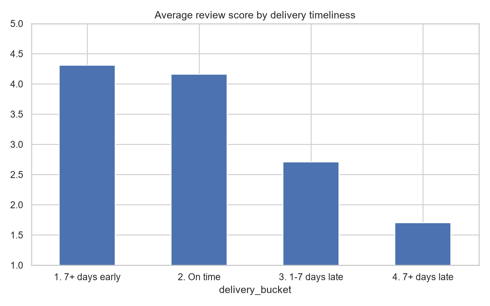
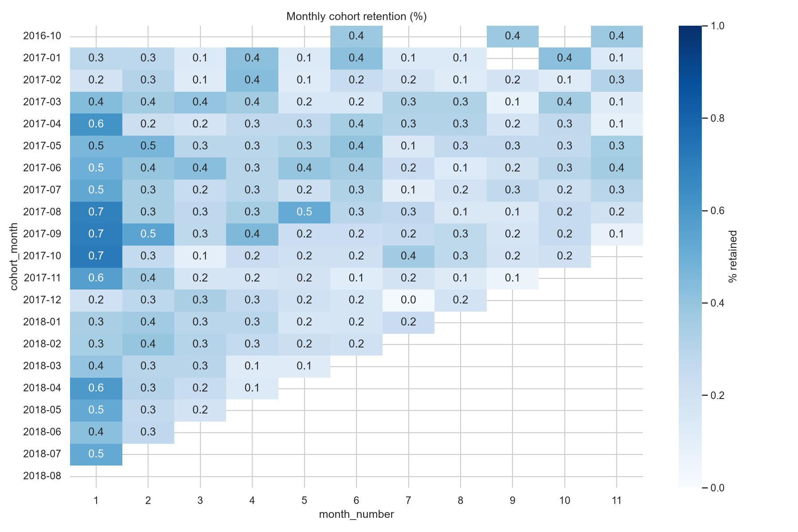
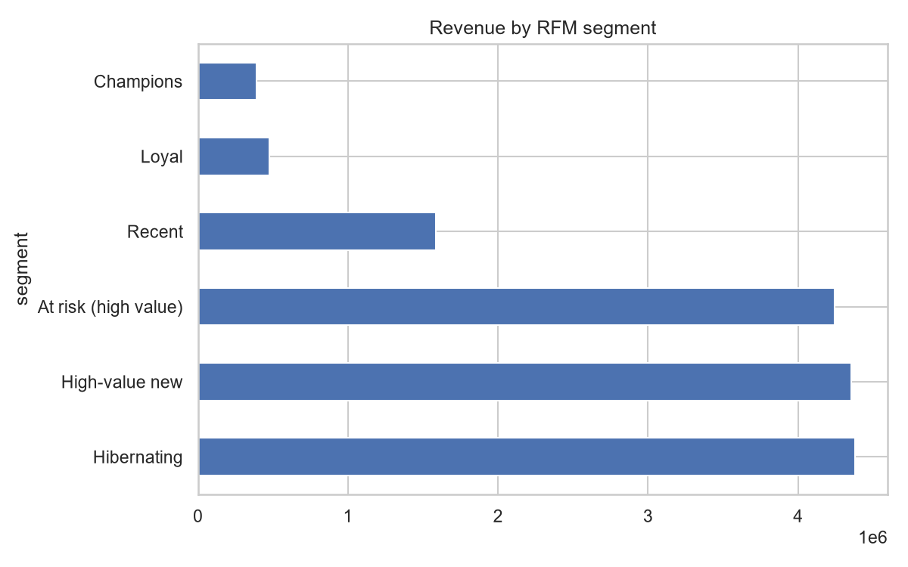

# E-commerce Funnel, Retention & Customer Segmentation Analysis

> **Business question:** Where is Olist losing customers, and what three actions would improve repeat purchases and revenue?

## Executive Summary
**96.5k delivered orders · 93.4k customers · R$15.4M revenue · R$160 AOV** (Sep 2016 – Aug 2018)

- **Olist is a one-and-done marketplace.** Only **3.0%** of customers ever place a second order, and month-1 cohort retention is **under 1%**.
- **Late delivery damages customer satisfaction.** 8.1% of orders arrive late. On-time orders average **4.2★**. Orders more than 7 days late average **1.7★**, and **79%** of their reviews are negative (1–2★), against about 10% for on-time orders.
- **Delays are regional.** In Alagoas (AL), **24%** of orders arrive late and delivery averages 24.5 days. In São Paulo (SP), it averages 8.7 days. The North-East states make up most of the late-delivery list.
- **Revenue is concentrated in lapsed customers.** "Hibernating" and "At-risk high-value" customers bring in **R$8.6M (56%)** of all revenue, but they haven't purchased in 1+ year.
- **Top categories:** health & beauty, watches & gifts, and bed/bath/table. Together they account for about 26% of item revenue.



## Recommendations
1. **Fix the delivery promise in the North-East.** Pad delivery estimates or add regional carriers or warehouses for AL, MA, PI, CE and SE. A late order is roughly 5× more likely to get a negative review.
2. **Launch a second-purchase program.** Send a post-delivery coupon 30 days after the first order to happy (4–5★) customers, and A/B test it against a holdout group. Raising the repeat rate from 3% to 5% means about 1.9k extra orders, or about R$300k at the current AOV.
3. **Win back high-value at-risk customers.** Run category-personalised reactivation campaigns for the 13.8k at-risk customers who previously spent heavily.

| Cohort retention | Revenue by segment |
|---|---|
|  |  |

📄 **[2-minute project summary](reports/project_summary.md)** · 📊 Dashboard: [`dashboard/olist_dashboard.pdf`](dashboard/olist_dashboard.pdf) · [why it's built this way](dashboard/README.md)

## Dataset
[Olist Brazilian E-commerce](https://www.kaggle.com/datasets/olistbr/brazilian-ecommerce): about 100k orders from 2016–2018 across 9 related tables.

## Analyses
| # | Analysis | File |
|---|----------|------|
| 1 | Order status funnel & KPIs | `sql/01_kpis_and_funnel.sql` |
| 2 | Monthly cohort retention | `sql/02_cohort_retention.sql` |
| 3 | RFM customer segmentation | `sql/03_rfm_segmentation.sql` |
| 4 | Delivery delay vs review score | `sql/04_delivery_vs_reviews.sql` |
| 5 | Category & regional revenue | `sql/05_category_region.sql` |

## How to run
```bash
pip install -r requirements.txt
# download the CSVs from Kaggle into data/raw/
python src/load_data.py          # builds data/olist.duckdb
python src/run_analysis.py       # runs SQL, saves charts to reports/figures
```

## Tools
SQL (DuckDB), Python (pandas, matplotlib/seaborn), Power BI

## Structure
```
data/raw/        raw Kaggle CSVs (gitignored)
sql/             analysis queries
src/             loading + analysis scripts
notebooks/       exploratory work
dashboard/       Power BI dashboard (PDF) + design rationale
reports/         project summary + figures
```
